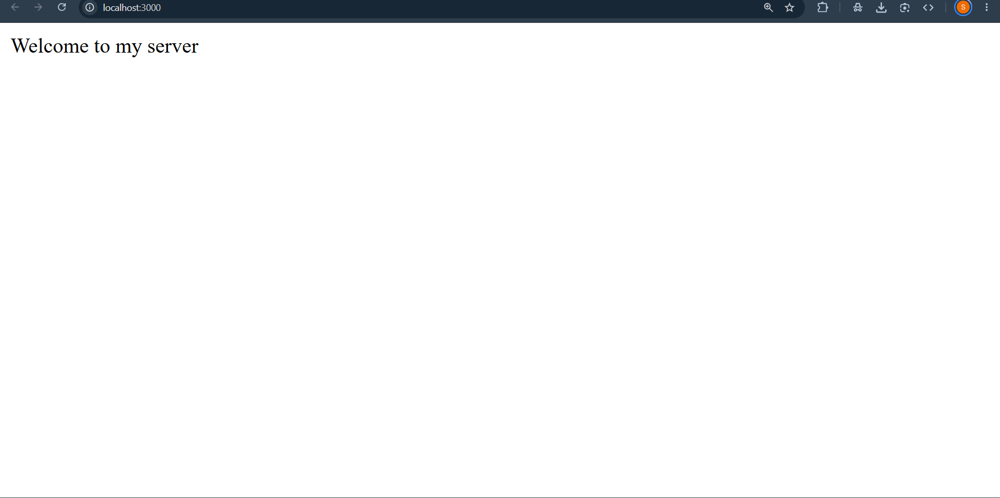
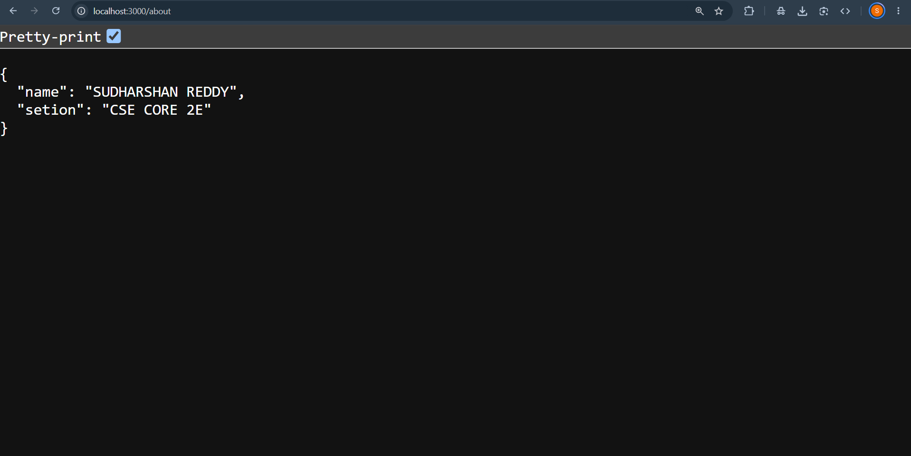
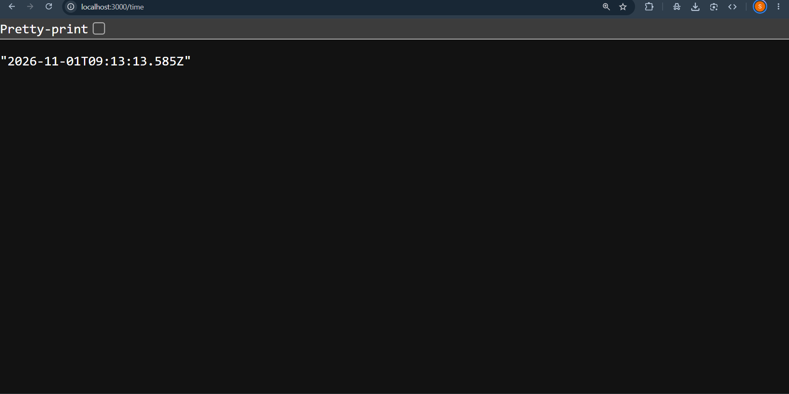
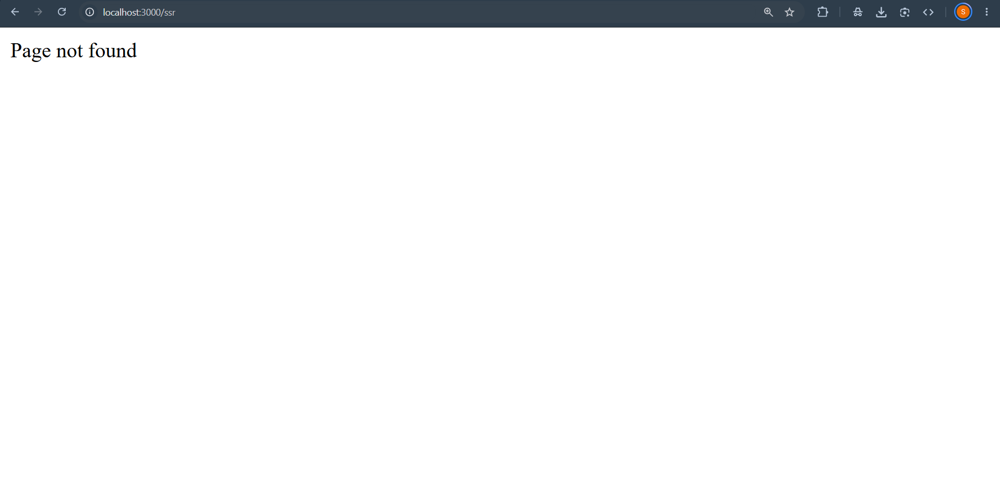

# Lab 1: Node.js and Express Server

## Student Details

- **Name:** SOMULA SUDHARSHAN REDDY
- **Registration Number:** 252U1R1231
- **Section:** CSE-CORE-2E

## Objective

To set up a Node.js project and build a web server using the built-in HTTP module and Express.js.

## Technologies Used

- Node.js
- Express.js
- JavaScript
- npm
- Nodemon

## Project Structure

```text
lab-01/
├── node_modules/
├── .gitignore
├── lab-01.http
├── package.json
├── package-lock.json
├── README.md
└── server.js
```

## Installation

Install the required dependencies:

```bash
npm install
```

## Running the Application

Start the server using Nodemon:

```bash
npm run dev
```

The server runs at:

http://localhost:3000/

## API Endpoints

| Method | Endpoint | Description |
|---|---|---|
| GET | / | Displays welcome message |
| GET | /about | Displays student name and section |
| GET | /time | Displays current date and time |
| GET | /contact | Returns 404 for unknown route |

## Expected Status Codes

| Endpoint | Status Code |
|---|---|
| GET / | 200 OK |
| GET /about | 200 OK |
| GET /time | 200 OK |
| GET /contact | 404 Not Found |

## Screenshots

### 1. Welcome Route



### 2. About Route



### 3. Time Route



### 4. 404 Route




## Notes

- Created a Node.js project using npm.
- Installed Express.js.
- Created a basic HTTP server using http.createServer().
- Implemented an Express server using express().
- Created three GET routes.
- Used new Date() to display the current date and time.
- Implemented a 404 response for unknown routes.
- Used Nodemon to restart the server automatically.


## Conclusion

Successfully created a web server using Node.js and Express.js. Implemented the required routes and verified their responses and HTTP status codes.
